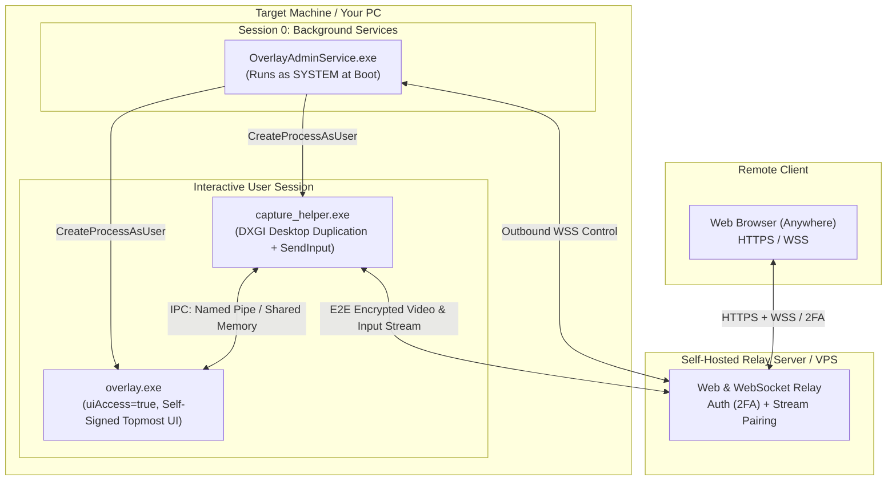

# Personal Remote KVM & Overlay System

A completely self-hosted, private remote desktop and status overlay engine designed to access and control your personal PC remotely through any browser without exposing your home network or relying on proprietary third-party platforms.

The system is split into three main layers:
1. **Cloud / VPS Relay Server**: Facilitates secure pairing, user authentication, and data transfer via outbound WebSockets (no port-forwarding required).
2. **SYSTEM Background Service**: Auto-starts at boot to handle session lifecycle management, survivability across user logoffs, and privileged orchestration.
3. **User-Session Helpers**: The actual and screen-capture/input engine running inside the interactive desktop session.

---

## Architecture Overview

---

## Components

| Component | Privilege / Level | Session | Responsibility |
|---|---|---|---|
| **Relay Server** | User / Container | Cloud / VPS | Hosts the web client, and bridges outbound WebSockets between browser and host. |
| **`hawk-service.exe`** | `NT AUTHORITY\SYSTEM` | Session 0 | Boots before user login, maintains outbound relay heartbeat, monitors logon events, and spawns session helpers. |
| **`hawk-capture.exe`** | `NT AUTHORITY\SYSTEM` (in the user session) | Active / secure desktop | Low-overhead screen capture via DXGI Desktop Duplication and input via `SendInput`. Runs as SYSTEM in the session and follows the input desktop so the UAC prompt and lock screen are captured and controllable too. |

---

## Windows Security Subsystems & Design Choices

### 1. Session 0 Isolation
Introduced in Windows Vista, background services run in an isolated session (`Session 0`) without access to any display hardware or interactive input devices. A service cannot capture the screen or display windows directly. 
* **Implementation:** The service queries active session IDs via `WTSEnumerateSessions` / `WTSQueryUserToken` and spawns interactive components into the user's session using `CreateProcessAsUser`.

### 2. Secure desktop & integrity (SYSTEM in-session)
The UAC consent prompt and the lock screen run on a separate **secure desktop** (`Winlogon`), whose DACL admits only `SYSTEM`; a user-session process (with or without `uiAccess`) is refused there, so DXGI returns `DXGI_ERROR_ACCESS_LOST` and can't duplicate it. `uiAccess` only bypasses **UIPI** (integrity isolation *within* a desktop), not desktop isolation — the accessibility tools visible on the UAC screen are there because Winlogon itself launches allowlisted uiAccess apps onto it.
* **Implementation:** `hawk-service` (LocalSystem) builds a SYSTEM primary token retargeted to the interactive session (`DuplicateTokenEx` + `SetTokenInformation(TokenSessionId)`, which needs `SeTcbPrivilege`) and launches `hawk-capture.exe` from it. Running as SYSTEM *in the session*, the helper attaches its capture and input threads to whichever desktop currently holds input (`OpenInputDesktop`/`SetThreadDesktop`), re-duplicating on each switch — so it captures and drives the secure desktop, the way an installed remote-support service does. System integrity (above High) also means injected input reaches elevated windows without `uiAccess`.
* **Trade-off:** the capture helper runs as SYSTEM rather than as the user. This is the privilege that secure-desktop capture requires.

### 3. Input Injection
Mouse and keyboard from the browser are replayed inside the interactive session by `hawk-capture.exe` with `SendInput` — the same helper that captures the screen, because only a process in that session can type into it.
* **Physical keys, not characters:** keys travel as the browser's `KeyboardEvent.code` (the key's position) and are injected as PS/2 set-1 **scancodes** (`KEYEVENTF_SCANCODE`). The machine then applies its own keyboard layout, exactly as it would to a keyboard plugged into it, and games that read scancodes see what they expect.
* **Resolution-independent pointer:** positions travel as a fraction of the captured monitor and are injected as absolute virtual-desktop coordinates (`MOUSEEVENTF_ABSOLUTE | MOUSEEVENTF_VIRTUALDESK`), so neither side needs the other's resolution and a mode change can't put the pointer somewhere else.
* **Nothing stays pressed:** the relay tells the machine to let go when a viewer stops watching or loses the right to control it, the browser releases what it is holding when the screen loses focus, and the helper releases everything it pressed when the pipe closes or it exits.
* **What can't be forwarded:** `Ctrl+Alt+Del` is the secure attention sequence, which only Windows itself can generate; and shortcuts the browser keeps for itself (`Ctrl+W`, `Alt+Tab`) stay on the viewer's own machine, unless the viewer is in full screen on a Chromium browser, where the dashboard takes a keyboard lock and forwards them too.

### 4. Outbound-Only Networking
Instead of opening firewall ports or port-forwarding a home router, both the browser and the target PC initiate outbound WebSocket connections to the self-hosted relay server. The relay handles session handshakes and pairs the two connections.

---

## Security Mitigations
* **Relay Authentication:** The cloud relay acts as the primary gatekeeper. Access requires strong authentication to prevent unauthorized remote sessions.
* **End-to-End Encryption (E2EE):** Video frames and input events are encrypted end-to-end between the interactive capture helper and your browser using a pre-shared or session-derived key. The relay server only routes opaque ciphertext payloads.
* **Granular IPC & Shared Memory Hardening:**
  * **Strict DACLs (No Broad `AU` Grants):** Cross-session shared memory objects (`Global\`) and synchronization events (`CreateEvent`) created by the SYSTEM service must not grant blanket `Authenticated Users` (`AU`) access. Instead, construct explicit SDDL strings or programmatic DACLs granting permissions strictly to `NT AUTHORITY\SYSTEM` and the specific logged-on user's SID retrieved via `WTSQueryUserToken`.
  * **Double-Buffering & State Validation:** Use double-buffered (ping-pong) shared memory paired with named Win32 events (`SetEvent` / `WaitForSingleObject`) with reasonable timeouts (e.g., 50–100ms) to prevent deadlock or race conditions if one process crashes or hangs mid-write.
* **Channel Separation (Control vs. Data):**
  * **Shared Memory (`CreateFileMapping` + `MapViewOfFile`):** Exclusively utilized for zero-copy transmission of bulk frame buffers.
  * **Named Pipes (`CreateNamedPipe`):** Retained for low-frequency control signaling, heartbeats, and input ingestion, isolated using strict pipe security descriptors and `PIPE_REJECT_REMOTE_CLIENTS`. Video and input get a pipe each, one-directional and in opposite directions, so a stalled video reader can never hold up input (or the other way round): `hawk-capture-<pid>-<n>` carries encoded frames up, `hawk-input-<pid>-<n>` carries input events down, one fixed-size message per event.
* **Self-Signed Scope & Isolation:** The custom root certificate generated for `uiAccess` signing is restricted strictly to the local machine's `Root` and `TrustedPublisher` stores and must never be distributed or imported onto foreign devices.
* **TLS Public Key Pinning (Anti-MITM):** The background service and capture helper do not rely solely on the Windows root trust store. They implement **SPKI (Subject Public Key Info) SHA-256 pinning** on outbound TLS/WSS connections to the relay server. Any connection where the server's public key hash does not match the embedded pin is immediately dropped, thwarting DNS hijacking, malicious proxies, and compromised root Certificate Authorities.
* **Hardware-Bound Identity via TPM 2.0:** The SYSTEM service leverages the **Microsoft Platform Crypto Provider** (ncrypt) to generate an asymmetric device identity key directly inside the motherboard's physical TPM. The private key is non-exportable and never enters system RAM or disk storage. During relay connection handshakes, the service signs authentication challenges entirely within the secure cryptoprocessor, preventing device spoofing even in the event of local disk imaging or storage theft.

---

## Compilation & Toolchain

TODO

---

## Implementation Roadmap

- [x] Background SYSTEM service architecture & session monitoring
- [x] MinGW-w64 cross-compilation pipeline and CMake setup
- [x] DXGI Desktop Duplication screen capture loop
- [x] Keyboard/mouse input ingestion via `SendInput`
- [x] Self-hosted web relay server
- [x] Web browser client (Canvas/WebGL stream player + input listener)
- [x] Secure-desktop (UAC / lock screen) capture and control: hawk-capture runs as SYSTEM in-session and follows the input desktop
- [ ] self-signed certificate automation
