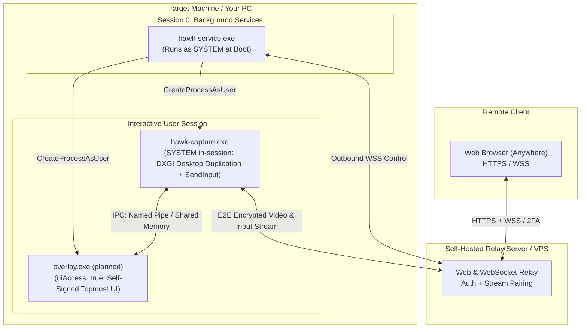

# Personal Remote KVM & Overlay System

A completely self-hosted, private remote desktop and status overlay engine designed to access and control your personal PC remotely through any browser without exposing your home network or relying on proprietary third-party platforms.

The system is split into three main layers:
1. **Cloud / VPS Relay Server**: Facilitates secure pairing, user authentication, and data transfer via outbound WebSockets (no port-forwarding required).
2. **SYSTEM Background Service**: Auto-starts at boot to handle session lifecycle management, survivability across user logoffs, and privileged orchestration.
3. **User-Session Helpers**: The actual and screen-capture/input engine running inside the interactive desktop session.

---

## Architecture Overview



---

## Components

| Component | Privilege / Level | Session | Responsibility |
|---|---|---|---|
| **Relay Server** | User / Container | Cloud / VPS | Hosts the web client, and bridges outbound WebSockets between browser and host. |
| **`hawk-service.exe`** | `NT AUTHORITY\SYSTEM` | Session 0 | Boots before user login, maintains outbound relay heartbeat, monitors logon events, and spawns session helpers. |
| **`hawk-capture.exe`** | `NT AUTHORITY\SYSTEM` (in the user session) | Active / secure desktop | Low-overhead screen capture via DXGI Desktop Duplication and input via `SendInput`. Runs as SYSTEM in the session and follows the input desktop so the UAC prompt and lock screen are captured and controllable too. |

---

## Windows Security Subsystems & Design Choices

### 1. Session 0 Isolation
Introduced in Windows Vista, background services run in an isolated session (`Session 0`) without access to any display hardware or interactive input devices. A service cannot capture the screen or display windows directly. 
* **Implementation:** The service queries active session IDs via `WTSEnumerateSessions` / `WTSQueryUserToken` and spawns interactive components into the user's session using `CreateProcessAsUser`.

### 2. Secure desktop & integrity (SYSTEM in-session)
The UAC consent prompt and the lock screen run on a separate **secure desktop** (`Winlogon`), whose DACL admits only `SYSTEM`; a user-session process (with or without `uiAccess`) is refused there, so DXGI returns `DXGI_ERROR_ACCESS_LOST` and can't duplicate it. `uiAccess` only bypasses **UIPI** (integrity isolation *within* a desktop), not desktop isolation — the accessibility tools visible on the UAC screen are there because Winlogon itself launches allowlisted uiAccess apps onto it.
* **Implementation:** `hawk-service` (LocalSystem) builds a SYSTEM primary token retargeted to the interactive session (`DuplicateTokenEx` + `SetTokenInformation(TokenSessionId)`, which needs `SeTcbPrivilege`) and launches `hawk-capture.exe` from it. Running as SYSTEM *in the session*, the helper attaches its capture and input threads to whichever desktop currently holds input (`OpenInputDesktop`/`SetThreadDesktop`), re-duplicating on each switch — so it captures and drives the secure desktop, the way an installed remote-support service does. System integrity (above High) also means injected input reaches elevated windows without `uiAccess`.
* **Trade-off:** the capture helper runs as SYSTEM rather than as the user. This is the privilege that secure-desktop capture requires.

### 3. Input Injection
Mouse and keyboard from the browser are replayed inside the interactive session by `hawk-capture.exe` with `SendInput` — the same helper that captures the screen, because only a process in that session can type into it.
* **Physical keys, not characters:** keys travel as the browser's `KeyboardEvent.code` (the key's position) and are injected as PS/2 set-1 **scancodes** (`KEYEVENTF_SCANCODE`). The machine then applies its own keyboard layout, exactly as it would to a keyboard plugged into it, and games that read scancodes see what they expect.
* **Resolution-independent pointer:** positions travel as a fraction of the captured monitor and are injected as absolute virtual-desktop coordinates (`MOUSEEVENTF_ABSOLUTE | MOUSEEVENTF_VIRTUALDESK`), so neither side needs the other's resolution and a mode change can't put the pointer somewhere else.
* **Nothing stays pressed:** the relay tells the machine to let go when a viewer stops watching or loses the right to control it, the browser releases what it is holding when the screen loses focus, and the helper releases everything it pressed when the pipe closes or it exits.
* **Ctrl+Alt+Del is asked for, not typed:** it's the secure attention sequence, which Winlogon only takes from the keyboard driver or from `SendSAS`, never from `SendInput`. The live view's **Ctrl+Alt+Del** button (or `Ctrl+Alt+End` on the screen, as in Remote Desktop) sends a sealed request, and the SYSTEM service calls `SendSAS(FALSE)`, which Windows only honours when the `SoftwareSASGeneration` policy allows services; `hawk-setup install machine` turns that on and puts it back on uninstall. Updates leave the policy alone, so a machine that updates into this needs `hawk-setup install machine` run once.
* **What can't be forwarded:** shortcuts the browser keeps for itself (`Ctrl+W`, `Alt+Tab`) stay on the viewer's own machine, unless the viewer is in full screen on a Chromium browser, where the dashboard takes a keyboard lock and forwards them too.

### 4. Outbound-Only Networking
Instead of opening firewall ports or port-forwarding a home router, both the browser and the target PC initiate outbound WebSocket connections to the self-hosted relay server. The relay handles session handshakes and pairs the two connections.

---

## Security Mitigations
* **Relay Authentication:** The cloud relay acts as the primary gatekeeper. Access requires strong authentication to prevent unauthorized remote sessions.
* **End-to-End Encryption (E2EE):** Video frames and input events are encrypted end-to-end between `hawk-service` and your browser, and the relay only routes ciphertext. The relay is also not trusted to decide who may watch: the owner's browser signs every share, and the machine checks those signatures against the owner key it pinned at enrollment. Each view is an ECDH exchange signed by the viewer's identity key and by the machine's TPM key; frames use AES-256-GCM under a stream key that rotates when a viewer leaves. Passwords never reach the relay; the browser derives what it sends from them. Details in `src/server/README.md`, "End-to-end encryption".
* **Granular IPC & Shared Memory Hardening:**
  * **Strict DACLs (No Broad `AU` Grants):** Cross-session shared memory objects (`Global\`) and synchronization events (`CreateEvent`) created by the SYSTEM service must not grant blanket `Authenticated Users` (`AU`) access. Instead, construct explicit SDDL strings or programmatic DACLs granting permissions strictly to `NT AUTHORITY\SYSTEM` and the specific logged-on user's SID retrieved via `WTSQueryUserToken`.
  * **Double-Buffering & State Validation:** Use double-buffered (ping-pong) shared memory paired with named Win32 events (`SetEvent` / `WaitForSingleObject`) with reasonable timeouts (e.g., 50–100ms) to prevent deadlock or race conditions if one process crashes or hangs mid-write.
* **Channel Separation (Control vs. Data):**
  * **Shared Memory (`CreateFileMapping` + `MapViewOfFile`):** Exclusively utilized for zero-copy transmission of bulk frame buffers.
  * **Named Pipes (`CreateNamedPipe`):** Retained for low-frequency control signaling, heartbeats, and input ingestion, isolated using strict pipe security descriptors and `PIPE_REJECT_REMOTE_CLIENTS`. Video and input get a pipe each, one-directional and in opposite directions, so a stalled video reader can never hold up input (or the other way round): `hawk-capture-<pid>-<n>` carries encoded frames up, `hawk-input-<pid>-<n>` carries input events down, one fixed-size message per event.
* **Self-Signed Scope & Isolation:** The custom root certificate generated for `uiAccess` signing is restricted strictly to the local machine's `Root` and `TrustedPublisher` stores and must never be distributed or imported onto foreign devices.
* **TLS Public Key Pinning (Anti-MITM):** The background service and capture helper do not rely solely on the Windows root trust store. They implement **SPKI (Subject Public Key Info) SHA-256 pinning** on outbound TLS/WSS connections to the relay server. Any connection where the server's public key hash does not match the embedded pin is immediately dropped, thwarting DNS hijacking, malicious proxies, and compromised root Certificate Authorities.
* **Hardware-Bound Identity via TPM 2.0:** The SYSTEM service leverages the **Microsoft Platform Crypto Provider** (ncrypt) to generate an asymmetric device identity key directly inside the motherboard's physical TPM. The private key is non-exportable and never enters system RAM or disk storage. During relay connection handshakes, the service signs authentication challenges entirely within the secure cryptoprocessor, preventing device spoofing even in the event of local disk imaging or storage theft.


---

## Frontend Hosting

The dashboard is a static bundle, so it doesn't have to be served by the relay. Two modes exist side by side, and a relay owner picks which ones their relay accepts (the desktop app uses the second):

* **Same origin (default, what exists today):** the relay serves the dashboard itself. Sessions are an `HttpOnly`, `SameSite=Strict` cookie and the dashboard socket is refused from any other `Origin`. Nothing cross-site is possible, and nothing changes for existing setups.
* **Separate origin (opt-in):** the dashboard is hosted anywhere static (GitHub Pages, a CDN, another server) and the user enters their relay's address, which is kept in their browser only, along with their session. Cross-site cookies are unreliable (third-party cookie blocking and partitioning), so this mode uses bearer tokens instead:
  * Login returns a session token that the page keeps in `localStorage` and sends as `Authorization: Bearer …`. A WebSocket can't carry headers, so the dashboard socket authenticates with its first message.
  * The relay only answers origins its owner lists (e.g. `HAWK_ALLOWED_ORIGINS=https://you.github.io`), through CORS for the API and an `Origin` allow-list for the socket. With the list empty, the relay behaves exactly as in same-origin mode.
  * The relay needs a certificate browsers trust (a domain with Let's Encrypt, or an IP certificate): a page on HTTPS can't reach a self-signed relay without the user first accepting it by hand, which mobile browsers make impractical. A relay on a private address (`192.168.x.x`) also triggers the browser's local-network permission prompt.
  * Frontend and relay can be on different versions, so the dashboard handshake carries a protocol version and the dashboard says so plainly when a relay is too old or too new.

**Trust:** whoever serves the dashboard serves the code that sees the password, holds the session and handles every frame and keystroke. Same-origin keeps that with the relay owner. A separately hosted dashboard moves it to whoever controls that host. Anyone can host their own copy, so no third party has to be trusted. Since the stream is end-to-end encrypted, a dashboard the relay doesn't serve is also the stronger setup: a compromised relay can't hand out modified code to read the stream it relays.

---

## Installation and updates

`hawk-setup` installs, updates and removes every part, from the project's releases. On Windows it opens a window in the dashboard's style when double-clicked; with a command it's a plain CLI that never opens one, for scripts and servers. Details: `/docs/machine`, `/docs/relay` and `/docs/updates` in the dashboard.

### Quick start

1. **Relay**, on a Linux server with systemd and a domain pointed at it. As root, with `hawk-setup-<version>-linux-x64` (or `-arm64`) from the [releases](../../releases):
   ```sh
   chmod +x hawk-setup-*-linux-x64
   ./hawk-setup-*-linux-x64 install relay --public-url https://relay.example.com --tls certbot --email you@example.com
   ```
   It ends by printing the relay's key pin and a one-time link to create the admin account.
2. **Admin account:** open that link, sign up, and set up two-factor login.
3. **Machine**, on the Windows PC to control. In the dashboard, *Machines → Add machine* shows the relay's address, its pin and a one-time code (valid one hour; keep the tab open until the machine appears). Run `hawk-setup-<version>-windows-x64.exe` as administrator and choose *Set up this PC*, or from an elevated terminal:
   ```powershell
   hawk-setup install machine --relay relay.example.com --pin <pin> --code <code>
   ```
4. **Desktop app** (optional; any browser does the same at the relay's address), then enter the relay's address. A relay installed by hawk-setup accepts the app out of the box.
   * **Windows:** `hawk-setup install app`, or `hawk-app-<version>-windows-x64-setup.exe` from the release.
   * **Arch Linux:** download the release's `PKGBUILD` into an empty folder, then `makepkg -si`. pacman updates it with the next release's `PKGBUILD`.
   * **Other Linux:** `hawk-app-<version>-linux-x64.AppImage`: `chmod +x` and run it. It updates itself. AppImages need FUSE 2 (`libfuse2`, or `fuse2` on Arch).

Releases aren't signed with a Windows code-signing certificate, so SmartScreen warns on the first run. What protects the install is hawk-setup's own check: everything it installs must match a manifest signed with the project's key (`minisign.pub`).

### What it sets up

* **Machine (Windows):** `hawk-setup install machine --relay … --pin … --code …`, the same three values the dashboard shows under *Add machine*. Preflight in plain words before anything is written (administrator, Windows version, TPM, relay reachable with the pinned key), then `Program Files\Hawk\Service`, the `HawkService` service (LocalSystem, auto-start, restart on failure), ProgramData locked to SYSTEM and administrators, an *Apps & features* entry, and enrollment followed live. Uninstall deletes the TPM key too.
* **Relay (Linux):** `hawk-setup install relay --public-url https://… --tls certbot|self-signed|existing`. A hardened systemd unit under its own `hawk` user, TLS whose key survives renewals (certbot `--reuse-key` and a deploy hook), firewall, and the pin and first admin invite printed at the end.
* **Desktop app:** on Windows `hawk-setup install app` or its own installer; on Linux an AppImage, or the release's `PKGBUILD` on Arch.
* **Updates:** every part checks a signed release feed (see `src/update`). The machine service runs `hawk-setup update machine` daily and the relay a systemd timer; each rolls back if the new version doesn't come up, the relay with its database. The app uses Tauri's updater against the same key. The policy (`notify`, `auto`, `off`), channel (`stable`, `beta`), feed URL and key are set per install, and builds default to the feed of the repository they were built from, so a fork works with nothing to edit.

### Releasing

`python scripts/bump-version.py 1.1.0`, commit, tag `v1.1.0`, push. CI (`.github/workflows/release.yml`) builds everything and leaves a draft release with the unsigned manifests. Then, on the machine holding the signing key, `python scripts/release/release-sign.py v1.1.0` signs the manifests and the app's installer, publishes the release, and moves the `feed` release to it. The signing key never touches CI: it ships code to every install. One-time setup: `minisign -G`, and put the public key (the second line of `minisign.pub`) in the repository variable `HAWK_UPDATE_PUBKEY`.

---

## Compilation & Toolchain

| Part | Toolchain | Build |
|---|---|---|
| `hawk-service`, `hawk-capture` | MSYS2 UCRT64 (GCC 15, CMake, Ninja) | `cmake -S . -B build -G Ninja -DCMAKE_BUILD_TYPE=Release && cmake --build build` (into `bin/`; MinGW's runtime is linked in) |
| Relay, `hawk-update`, `hawk-setup`, app | Rust (stable, edition 2024), one Cargo workspace at the root | `cargo build --release -p hawk-relay` / `-p hawk-setup [--features gui]` / `-p hawk-app` |
| Dashboard, setup window | bun | in `src/server`: `bun install`, then `bun run --cwd frontend build` (relay-served), `build:app` (standalone, for the app), `build:setup` (hawk-setup's window) |

`VERSION` is the one version for everything; `scripts/bump-version.py` copies it where it can't be read directly.

---

## Implementation Roadmap

- [x] Background SYSTEM service architecture & session monitoring
- [x] MinGW-w64 cross-compilation pipeline and CMake setup
- [x] DXGI Desktop Duplication screen capture loop
- [x] Keyboard/mouse input ingestion via `SendInput`
- [x] Self-hosted web relay server
- [x] Web browser client (Canvas/WebGL stream player + input listener)
- [x] Secure-desktop (UAC / lock screen) capture and control: hawk-capture runs as SYSTEM in-session and follows the input desktop
- [x] End-to-end encryption of video and input, with viewer access decided by the owner's signatures rather than the relay
- [ ] Self-signed certificate automation
- [x] Multi-factor authentication: TOTP, recovery codes, step-up, admin policy and reset
- [x] WebAuthn / passkeys as a second factor and for step-up (security keys, platform and synced passkeys)
- [ ] Passwordless sign-in with a passkey
- [x] Email ownership verification and security notices (when the relay has a mailer)
- [ ] Trusted-proxy address resolution, with IP allow/deny lists
- [x] Machine analytics (CPU/RAM/GPU/disk/network, processes) with charts, history kept on the machine, end-to-end encrypted
- [ ] Analytics alerts (disk full, machine silent), sparklines in the machine list, temperatures, ending processes
- [x] `dev` role: a shell instead of a video stream, for low bandwidth (ConPTY as the logged-on user)
- [x] GUI and CLI installer (`hawk-setup`): machine, relay, app; preflight, repair, uninstall
- [ ] Installer pre-stamped by the dashboard with relay URL, pin and enroll code; Authenticode signing
- [x] Machine config file, schema-described and synced to the dashboard: control reads it, the owner edits it
- [ ] Multiple display support (per-display capture, display-aware input)
- [x] Touch input: trackpad and direct modes, pinch-zoom of the picture on the viewer's side, the phone's keyboard and a row of extra keys
- [x] Text input as characters (`KEYEVENTF_UNICODE`), independent of the machine's keyboard layout
- [x] Audio (WASAPI loopback, Opus) alongside the video stream
- [x] Audio on the MSE fallback (Firefox for Android): Opus muxed into fragmented MP4
- [x] A/V sync: video slewed to the audio clock, a prefer latency / prefer sync toggle
- [x] Output device picker: listed for anyone watching, chosen by control for the stream
- [x] Quality presets, and Auto: adaptive bitrate steered by the relay from its own queues
- [ ] Quality: capture scale, keyframe interval, per-viewer layers (simulcast / SVC)
- [x] Clipboard sync (text): paste into the machine, pull from it, or sync, set by the machine's config file
- [x] Clipboard pictures: PNG both ways under the same modes, chunked so a large one never holds up input or video
- [x] File transfer into and out of one drop folder, resumable and hash-checked, off unless the machine's config turns it on
- [x] Remote power actions (lock, sign out, restart, shut down), reboot-and-reconnect, remote sign-in at the sign-in screen
- [x] Ctrl+Alt+Del from the live view (`SendSAS` from the service), including at a sign-in screen that asks for it
- [ ] Wake-on-LAN via a LAN peer, sleep and hibernate
- [ ] Relay operations: container image, health endpoints, metrics, backups
- [ ] Trusted devices (remember a browser after MFA)
- [x] Separately hosted dashboard: bearer-token sessions, `HAWK_ALLOWED_ORIGINS` (CORS + socket `Origin` allow-list), relay address entered in the browser, protocol version in the handshake
- [x] Relay installer (Linux): `systemd` service, Let's Encrypt or self-signed TLS with a stable pinned key, frontend modes, first admin
- [x] Signed updates for every part from one release feed, with rollback; release CI on tags, signing offline
- [ ] GitHub Pages workflow for hosting the dashboard on its own
- [x] Native dashboard app (Tauri): standalone dashboard, signed updates
- [ ] Native dashboard app: full keyboard capture, identity key in the OS keychain
- [x] Session audit log: sign-ins, views, shells, files, power and config actions, shares, per account, machine and relay
- [ ] Audit log follow-ups: alerts (a sign-in from a new address), recordings kept on the machine
- [x] `/docs` in the dashboard: setup and usage guide, public, Markdown rendered at build time
- [ ] `/docs` follow-ups: prerendered HTML, search, generated reference tables, help links in context
- [ ] `/about` page (late: once features and the name settle)

Each of the unchecked items is described under [Planned Features](#planned-features).

---

## Planned Features

Design intent for the work that isn't built yet. Nothing in this section is
implemented; it's here so the shape is settled before the code is.

### Multi-factor authentication (TOTP, passkeys and recovery codes built)

The relay is the only gate in front of every machine, so a stolen password
has to not be enough. TOTP, passkeys as a second factor, recovery codes,
step-up, the admin policy and reset are built (`src/server/README.md`,
"Two-factor authentication"), as are email verification and security
notices. Passwordless sign-in and email codes are still to come. In rough
order of value:

* **TOTP** (RFC 6238, any authenticator app) — the baseline, works offline
  and needs nothing from the browser.
* **WebAuthn / passkeys** — hardware keys (YubiKey, Titan) and platform
  authenticators (Windows Hello, Touch ID, Android). Phishing-resistant
  because the credential is bound to the relay's origin, which a password
  or a TOTP code never is. Built as a second factor, accepted wherever a
  code is and offered first. Still to come: the passkey-only login that
  skips the password entirely, which needs discoverable credentials (the
  account's random WebAuthn user handle is already kept for it) and a
  thought-out answer for the identity key, which is unwrapped with the
  password today. Long-term that's the one worth making the default.
* **Recovery codes** — a short set of single-use codes shown once at
  enrollment, stored the way session and invite tokens already are (32
  random bytes, only the SHA-256 kept). Without these, a lost phone means
  an account only the admin can rescue.
* **Email codes** — last resort, and only where the relay has a working
  mailer. Weaker than the others (it moves the trust to the mailbox), so it
  should be opt-in rather than offered alongside the strong methods.

Design points:

* **More than one factor registered at a time.** A phone and a hardware key,
  with any of them satisfying the login, so losing one isn't a lockout.
* **Step-up, not just login.** Some actions deserve a fresh factor even in
  an already-authenticated session: enrolling or removing a machine,
  granting a share, taking control of a machine, opening a shell (see the
  **dev** role), and every Admin tab action. The check is on the relay, per
  request, with a short grace window — not a dashboard-side confirmation.
* **Admin policy.** The admin can require MFA for all accounts, or for
  accounts holding a `control`/`dev` share, and see who has it enrolled.
* **Enrolling MFA ends other sessions** and is itself a step-up action, so
  someone who has stolen a session cookie can't quietly add their own factor.
* Secrets at rest: TOTP seeds encrypted (not just hashed — they have to be
  recoverable to verify), WebAuthn credentials are public keys and need no
  protection beyond integrity. Verification is rate-limited per account as
  well as per IP, because the code space is small.

### Safe IP forwarding, allow lists and deny lists

Two problems that have to be solved in this order, because the second is
worthless without the first.

**1. Trusting the forwarded address.** Failed logins are throttled per
client IP today, and the relay behind a reverse proxy sees only the proxy,
so every client shares one bucket. Reading `X-Forwarded-For` naively is
worse than not reading it: any client can send the header and pick its own
identity, defeating the throttle and any list built on it. The fix is an
explicit `HAWK_TRUSTED_PROXIES` (CIDRs) plus the number of hops the relay
actually sits behind — the client address is the *n*-th entry from the
right, and the header is ignored outright from a peer that isn't a trusted
proxy. No trusted proxies configured means the socket's peer address is the
only truth. The same resolved address is then what the throttle, the audit
log and the session list record.

**2. Lists.** Once the address is trustworthy, CIDR allow/deny lists (IPv4
and IPv6) at three scopes:

* **Relay-wide**, in config — a blanket deny for abusive networks, and
  optionally an allow list that turns the dashboard into a deny-by-default
  service reachable only from named networks.
* **Per account** — "my dashboard only logs in from home and the office."
* **Per machine** — "this machine accepts viewers only from these
  networks", set machine-side so a compromised relay account can't widen it
  (see the synced config file).

Evaluation is fail-closed and fixed in order: deny list wins over allow
list, a non-empty allow list implies deny for everything else, and a
request with no resolvable client address is denied when any list is
active. Lists apply to dashboard logins, to `/v1/dashboard` sockets and to
machine (`/v1/ws`) connections, with the rejection logged and visible in the
dashboard — a lockout that gives no feedback is a lockout you can't fix.

### Machine analytics (built: history on the machine, not the relay)

Built as the **Analytics** and **Processes** tabs, with one change from the
plan below: the history stays **on the machine** (one point a second for an
hour, one a minute for `history_days`, in `ProgramData\HawkService\metrics`)
and reaches the dashboard over the end-to-end encrypted session, so the relay
sees none of it. Who may read it is a signed `analytics=1` in the owner's
grant, which the machine checks. Not built yet: temperatures, the relay-side
alerts below (they'd need the relay to see the numbers), sparklines in the
machine list, and ending a process. The original plan:

The dashboard knows whether a machine is online and nothing else about it.
The service already holds an authenticated control channel; sampling the
machine's health over it is nearly free and useful exactly when the screen
stream isn't running.

* **What's sampled:** CPU (total and per-core, plus package temperature
  where it's readable), memory (used/available/committed), per-volume disk
  space and I/O throughput, GPU (utilisation, VRAM, temperature — D3DKMT
  counters as the portable floor, NVML/ADL where the vendor runtime is
  present), network throughput per adapter, uptime, battery, and the top
  few processes by CPU and working set.
* **Rates:** ~1 Hz while someone has the machine's page open, one sample
  every 10–30 s otherwise. Kilobytes a minute, so it stays on while nobody
  is watching the screen — which is the point.
* **Retention:** a ring buffer on the machine covers a stream gap; the
  relay keeps a downsampled history in SQLite (1 s for an hour, 1 min for a
  week, 5 min for a few months) so the charts have a past without the
  database growing without bound. Retention and sampling are config, and
  telemetry can be switched off per machine.
* **Charts:** sparklines in the machine list, a full panel per machine —
  time series for CPU/RAM/GPU/network, a filled gauge per volume, the
  process table beside them. Same accent colour and light/dark treatment as
  the rest of the dashboard, no chart junk, and readable at a glance on a
  phone.
* **Alerts** fall out of this almost for free: disk nearly full, a machine
  that has stopped reporting, sustained load, a thermal ceiling.

### `dev` role: a shell, and nothing else (built)

A third share role beside **view** and **control**. It grants a terminal on
the machine (and file transfer, where the machine allows it) and no video
stream at all: a few kilobytes a second instead of a few megabits. That
makes a machine usable over tethered data, hotel Wi-Fi or a train. For
anything that isn't inherently graphical it's also simply faster. The owner
gets shells too; control shares don't.

Roles are capabilities, not a ladder:

| | screen | input, clipboard | files | shell |
|---|---|---|---|---|
| view | ✓ | read, if `view_pull` | | |
| control | ✓ | ✓ | ✓ | |
| dev | | | ✓ | ✓ |
| owner | ✓ | ✓ | ✓ | ✓ |

The machine enforces this itself, and the relay checks the same table. A
dev viewer is never given the stream key, so frames are unreadable to it
whatever the relay forwards, and capture doesn't even start for it.

* **How:** a ConPTY (`CreatePseudoConsole`) running the configured command,
  with bytes going both ways over the viewer's end-to-end encrypted channel
  and `xterm.js` in the dashboard (loaded only when a terminal is first
  opened). Resizes travel as their own message. Each viewer can have 2
  shells and the machine 4. In the dashboard they're tabs in the Terminal
  tab, which can go full screen with keyboard lock, so Ctrl+W, Alt+Tab and
  Esc reach the shell (holding Esc leaves).
* **Privilege.** This is the sharpest edge in the whole system, so the shell
  is **not** SYSTEM. It runs as the interactive user, with that user's
  environment and home directory, and the service refuses to open one
  when nobody is logged on or the token is LocalSystem. Every shell runs
  in a job object that kills everything it started once the shell closes:
  the tab closing, the viewer leaving, or the connection dropping.
* **Flow control.** At most 256 KB of output is unacknowledged per shell,
  and the dashboard only acknowledges what the terminal has drawn, so a
  command printing without end can't flood the relay or the viewer.
* **Machine-side opt-in.** Off unless the machine's config turns it on, and
  the config is set on the machine, never through the relay:

  ```toml
  [[shell]]
  enabled = true
  command = "powershell.exe -NoLogo"   # pwsh.exe, cmd.exe, ...
  ```

* **Accountable.** Every shell is logged with who opened it, as which user,
  for how long and how many bytes each way. Keystrokes are never logged.

Opening a shell is an MFA step-up action: the view has to be elevated
with a fresh code first. Not yet: running shells as a dedicated
low-privilege account instead of the logged-on user, and recording
sessions for the owner to read back.

### Installer (built, except the stamped download and code signing)

`hawk-setup` (see "Installation and updates") is built: GUI and silent CLI,
preflight, live enrollment, update, uninstall with the TPM key. Still to
come: the dashboard handing out a copy already stamped with the relay URL,
pin and code, and Authenticode signing. The original plan:

`install-service.ps1` with a pasted enrollment code is a developer's
install. The replacement: a signed, single-file GUI installer the dashboard
hands out already stamped with the relay URL, its TLS pin and a one-time
enrollment code — so installing a machine is a double-click and a UAC
prompt, and a leaked installer is useless after the code's hour is up.

* Preflight with plain-language results, not error codes: Windows version,
  administrator rights, a usable TPM (and a clear "software key instead"
  note when there isn't one), whether the relay is reachable and whether its
  key matches the embedded pin — checked *before* anything is written.
* Installs the service, generates and trusts the `uiAccess` signing
  certificate (the machine-local root that the self-signed-certificate
  automation item covers), registers the service, starts it, and then shows
  enrollment happening live: connected → challenge signed → enrolled, with
  the machine appearing in the dashboard while the window is still open.
* Repair, update and a clean uninstall from the same binary, including
  removing the TPM key and the local root — an installer that can't fully
  undo itself has no business asking for SYSTEM.
* A silent mode (`/quiet` with the same parameters) so the scripted path
  keeps working for fleets, and the PowerShell scripts stay for people who
  prefer them.

### Synced configuration file (built)

Built: the machine's **Config** tab shows its `config.toml` as a form. The
schema lives in one place, `settings()` in `src/service/config.cpp`: each
setting's type (on/off, a whole number in a range, one of a list, text),
its default, one line of help, whether it applies live or at the next
start, and whether it's locked by default. The machine sends that schema
with the values over a sealed `config` channel (its own session key), so
the dashboard renders whatever it's sent. Control and the owner read it;
only the owner changes it, elevated: the relay passes a change through the
step-up gate for the owner alone, and the machine checks the role again.
A change names the version (a hash of the file) it was made against; the
machine refuses it if the file changed since, checks each value against
the schema and the `[[locked]]` list, edits only those lines (comments
stay), parses the result with the same rules it starts with, and renames
it over the file. The clipboard settings and `audio.enabled` apply at once
(hawk-capture restarts for a moment); the rest when the service next
starts, and are marked so. The shell, file transfer, the drop folder, the
relay URL and the update feed and key are locked unless the machine's own
`[[locked]]` list says otherwise. Not yet: watching the file for local
edits (the tab shows the file as it is on disk, and a local edit still
needs a restart), and the display, network and encoder settings, which
don't exist yet. The original plan:

Every machine keeps one canonical, human-editable config
(`C:\ProgramData\HawkService\config.toml`). The machine is the source of
truth for it; the relay is a mirror and an editor.

* **Schema-described, so the UI is generic.** The machine sends the config
  *and* a description of it — each key's type, range, default, unit, one
  line of help, and whether it's writable remotely. The dashboard's machine
  Settings tab renders that description, so a new setting on the machine
  shows up in the UI without touching the frontend.
* **Flow:** the machine sends config + schema + a version counter on
  connect and after any local edit (it watches the file). A dashboard edit
  goes down the control channel with the version it was based on; the
  machine validates it, writes atomically, applies what it can live,
  reports the effective config and bumps the version. A stale version is
  rejected rather than merged, and the dashboard reloads and says so.
  Settings that need a restart are marked as such.
* **Locally locked keys.** A `[locked]` list in the file names keys the
  relay may only read. Anything that widens access belongs there and
  defaults there: `shell.enabled`, `capture.secure_desktop`,
  `displays.shareable`, `net.allow`/`net.deny`, `relay.url`,
  `relay.pins`. The physical machine always wins over the account that
  shares it.
* **What it holds:** encoder choice (NVENC/QSV/AMF/x264) and its bitrate,
  frame-rate and resolution caps; idle timeout; which displays are
  shareable; the on-machine indicator; telemetry on/off, sampling and
  retention; shell settings; the relay URL and pins; log level and log
  retention.

### Multiple displays

Today capture takes one output. A machine with two or three screens should
let the viewer choose, or see them all.

* The service enumerates DXGI adapters and outputs and reports each one's
  geometry, origin in the virtual desktop, rotation, DPI and refresh rate.
  The dashboard shows a to-scale layout of the screens; the viewer clicks
  one, or picks **All displays** for a stitched virtual-desktop capture.
* One `IDXGIOutputDuplication` and one encoder per selected output;
  switching displays doesn't restart the session, and two viewers can watch
  different screens of the same machine at once.
* **Input has to carry the display.** Pointer positions are a fraction of a
  monitor, which is only unambiguous once the message says *which* monitor;
  the helper maps it through that output's origin into absolute
  virtual-desktop coordinates. Without this, a second monitor puts the
  cursor on the first one.
* Hot-plug, resolution changes, rotation and a laptop lid closing all
  invalidate a duplication (`DXGI_ERROR_ACCESS_LOST`); the helper
  re-enumerates and re-duplicates, and the dashboard's layout updates live
  rather than freezing on a screen that no longer exists.
* `displays.shareable` in the config keeps a screen private — a second
  monitor that never leaves the room even when the machine is shared.

### Audio (built)

Built: hawk-capture captures the default render endpoint with WASAPI
loopback on a thread of its own. It asks Windows to convert to 48 kHz
stereo float, and converts the device's mix format itself where Windows
won't. It encodes Opus (libopus, 20 ms frames, 96 kbit/s) and writes the
packets down the capture pipe with an audio flag, on the video's clock.
The service seals them into the stream like frames (flag `0x02` in the
clear). The relay passes them on without waiting for a keyframe, but only
after it has said `start_capture { audio: true }`, so an older relay's
dashboards never get them. The dashboard decodes them with a WebCodecs
`AudioDecoder` and schedules them back to back on an `AudioContext`, with
an 80 ms cushion. It drops late packets to stay under 400 ms. Without an
`AudioDecoder` (Firefox for Android) the packets are muxed into fragmented
MP4 (an `Opus` track with its `dOps`) and played by an `<audio>` element
through a MediaSource of its own, not a second track beside the video's,
so a quiet spell can't stall the picture; it jumps forward when it falls
400 ms behind. A default device change is followed, silence isn't sent,
and `[[audio]] enabled` turns it off. Packets are stamped from WASAPI's
own QPC position, so the stamp is when the sound played, not when it was
read. **Sync to sound** in the live view trades latency for sync: a 150 ms
cushion, and each picture held (300 ms at most) until the sound of the
same instant is heard; on MSE the `<video>`'s rate is steered toward the
sound's clock instead. With no sound heard (quiet, muted) the picture runs
free. `?debug` shows the gap as `a/v`. **Sound ▾** lists the machine's
active render endpoints (the service enumerates them itself, over a sealed
`audio` channel with its own session key); control or the owner, elevated,
can pick one, which restarts hawk-capture with `--audio-device`. The
choice lasts for the stream and is never saved; a chosen device that goes
away falls back to the default until it's back. The original plan:

* **Capture:** WASAPI loopback (`IAudioClient` with
  `AUDCLNT_STREAMFLAGS_LOOPBACK`) on the default render endpoint, encoded as
  **Opus** — 48 kHz stereo, 20 ms frames, 96–128 kbit/s. Against a few
  megabits of H.264 that is free, so it can simply be on.
* **Which session.** Audio endpoints belong to the logon session, and the
  capture helper already runs *inside* it (as SYSTEM, following the input
  desktop), so loopback keeps working while the screen is locked or a UAC
  prompt is up — the user session goes on playing even though its desktop
  isn't the one on screen. There is nothing to capture before anyone signs
  in, and nothing to capture on a machine with no audio device; both report
  as "no audio" rather than failing the session.
* **Playback:** Opus through WebCodecs `AudioDecoder` into a WebAudio
  graph. The MSE fallback path (Firefox for Android) gets Opus muxed into
  fragmented MP4, the same shape the video fallback already uses.
* **Keeping it in sync.** Frames already carry a capture timestamp; audio
  packets get a timestamp from the same clock, the player holds a small
  jitter buffer (60–100 ms) and slews video presentation to the audio
  clock, which is the one a listener notices drifting. A **prefer latency /
  prefer sync** toggle, because interactive control wants the buffer as
  small as it can be and watching something wants it stable.
* **Silence costs nothing.** Loopback hands over silence rather than
  stopping, so the helper detects it and sends a gap marker instead of
  packets; a quiet machine uses no audio bandwidth at all.
* **One direction only.** Viewer microphone → machine speakers would need a
  virtual audio *device* on the machine, which means a signed kernel-mode
  driver and an install story far heavier than the rest of the system. Out
  of scope deliberately, not forgotten.
* Gated as part of watching (so **view** is enough), switchable off per
  machine with `audio.enabled`, with a device picker when the machine has
  several render endpoints, and muteable client-side. The **dev** role has
  no stream, so no audio.

### Clipboard sync and file transfer

The two things people reach for within a minute of getting a remote
desktop, and the two with the sharpest privacy and privilege edges.

**Clipboard (built).** Text (`CF_UNICODETEXT`), and pictures as PNG. The
directions are *not* symmetrical:

* **Viewer → machine** (paste into the machine) requires **control**; it's
  an input event in everything but name.
* **Machine → viewer** is a leak if it streams: the machine's user copies a
  password manager entry and it lands on a watcher's machine without anyone
  deciding to send it. So the default is **pull**: the viewer presses
  *Get clipboard*, and that single read is logged. **sync** (every copy on
  the machine is pushed to viewers allowed to read it) is something the
  machine's owner opts into.
* Capped at 256 KB of UTF-8, rate-limited by the relay, and never offered
  to a **view** share unless `view_pull` says so.
* **Pictures** follow the same rules (paste in with control, pull or sync
  out, `view_pull` for view shares), and `images = false` keeps the
  clipboard to text. They travel as PNG, the one image format browsers put
  on their clipboard: the machine sends the `PNG` format an app put there
  as it is, or encodes `CF_DIBV5` / `CF_DIB` (24- or 32-bit, either way up;
  an alpha that's zero throughout counts as opaque) with WIC. A pasted
  picture goes on as `PNG`, `CF_DIBV5` with its alpha, and a 24-bit
  `CF_DIB` laid over white for the apps that ignore alpha. When the
  clipboard holds text too (cells, a slide), the text goes. At most 8 MB
  of PNG and 8K pixels (and 16384 on a side); a larger picture is skipped
  with a note, never cut.
* A picture doesn't fit a clipboard message, and one 8 MB message would
  hold up everything queued behind it on the socket for seconds. So it
  goes in 64 KB chunks over an image channel of its own, four
  unacknowledged at a time either way: the relay queues the machine's with
  file data, behind input, events and video, and what a viewer pastes
  waits behind no more than a quarter megabyte of it. The relay budgets it
  apart from text, which stays as quick as it was. Machines and dashboards
  older than protocol 9 keep text alone, with no errors either side.

It's set in the machine's own `C:\ProgramData\HawkService\config.toml`,
read when the service starts, or by the owner from the machine's Config
tab (see *Synced configuration file*):

```toml
[[clipboard]]
mode = "pull"        # off | pull | sync
max_size = 262144    # bytes of UTF-8, at most 262144
view_pull = false    # let view-only shares read it too
images = true        # pictures too, as PNG of up to 8 MB
```

A missing file, or one with no `[[clipboard]]` table, means these defaults.
A file that doesn't parse, an unknown mode, or a second `[[clipboard]]`
table turns the clipboard **off** and logs why. A typo never opens up more
than the defaults would.

How it works:

* The clipboard belongs to the interactive session, so hawk-capture is the
  one that touches it. It does this on a thread of its own, with a
  message-only window and `AddClipboardFormatListener`; that thread stays
  on the default desktop while capture and input follow the secure one. It
  talks to the service over a third SYSTEM-only pipe (`hawk-clip-*`, framed
  as in `src/common/clipboard_pipe.hpp`). That pipe is only created when the
  config doesn't say `off`, and the listener only runs in `sync` mode.
  hawk-capture only runs while someone is watching, so the clipboard is
  reachable only then too. Each end checks a message's size against its
  kind's cap (256 KB of text, 8 MB of PNG) before reading it.
* Requests are sealed end to end (see the relay's README). The machine
  checks every one against the viewer's role and the config, whatever the
  dashboard showed. It logs who did what and how many bytes, never the
  text or the picture.
* In sync mode, a copy is reported once the clipboard settles, so one copy
  is one push. What a viewer pasted isn't pushed back. A newer picture
  replaces one still on its way.

**File transfer (built).** Drop files on the screen (or use *Send files*
in the machine's Files tab) to send them; the tab lists the machine's drop
folder to download from. Chunks travel over the viewer's end-to-end
encrypted channel, so the relay stores and sees nothing. Both ways need
**control**, **dev** or the owner; a view share never gets the tab, and the
relay and the machine both refuse it.

* **Into one directory, never an arbitrary path.** A remote write to a path
  the viewer chooses is a privilege escalation with extra steps: the
  Startup folder, or a DLL beside an executable. Uploads land in one drop
  directory (the logged-on user's `Downloads\Hawk` by default). Names are
  sanitised: only the last path component counts, reserved characters and
  device names are replaced, and a name that's taken becomes `name (1).ext`.
* **As the user, not as SYSTEM.** Every file operation runs impersonating
  the logged-on user, so a viewer gets exactly that user's rights in the
  drop folder. A junction the user plants there leads nowhere the user
  couldn't already write.
* **Coming back the other way** is the same drop directory: the machine's
  user puts a file there and the dashboard lists and downloads it. A full
  remote file browser is a separate, larger feature with its own access
  rules, and shouldn't be smuggled in as part of a transfer.
* **SHA-256 per transfer, and resume by offset.** An upload is hashed in the
  browser first and written to a hidden partial file named after its hash
  and size. Offering the same file again (after a dropped connection, say)
  picks up where it stopped, and it only gets its real name once the whole
  thing hashes right. A download is hashed by the machine first and checked
  by the browser at the end; an interrupted one asks for the rest. Partial
  files nobody came back for are removed after a week.
* **Bounded all the way.** Each side keeps 8 chunks of 64 KB
  unacknowledged per transfer, at most 2 transfers each way per viewer and
  6 on the machine. The relay queues file data per dashboard behind events
  and video, dropping what overflows rather than buffering it (the transfer
  stalls and resumes). It also caps how fast one dashboard can push.
* **Logged:** who sent or fetched which file, its size and its hash.
* In Chromium the browser streams a download straight to the file the
  viewer picks; elsewhere it's held in memory and saved at the end.

It's off unless the machine's config turns it on:

```toml
[[files]]
enabled = true
drop_dir = ""            # empty: the logged-on user's Downloads\Hawk
max_size = 1073741824    # bytes per file, either way; at most 64 GiB
```

`drop_dir` may use the user's environment variables. Write it as a TOML
literal string (`'%USERPROFILE%\Desktop\Drop'`) or double the backslashes:
in a `"..."` string, `\D` is an invalid escape and the config won't parse. As
with the clipboard, a config that doesn't parse, or a second `[[files]]`
table, turns file transfer off.

Both pair especially well with the **dev** role: a shell plus a clipboard
plus a file drop covers most of what the GUI was being used for.

### Remote power actions, reboot-and-reconnect and Wake-on-LAN (built, except Wake-on-LAN, sleep and hibernate)

Built: lock, sign out, restart and shut down from the live view's **Power
▾** menu, sealed end to end like input. The relay holds a machine that
announced a restart as *restarting* for up to ten minutes. hawk-capture
runs at the sign-in screen when nobody is signed in, and the service
relaunches it whenever the console moves to another session. Still to
come: sleep, hibernate and Wake-on-LAN. Lock is a disconnect of the
console session (`WTSDisconnectSession`), which the service can do
without going through the helper. The original plan:

The usual reason to still need someone physically at the machine is that it
needs a restart, or it's off.

* **Actions:** lock, sign out, sleep, hibernate, restart, shut down. The
  service is LocalSystem and can enable `SeShutdownPrivilege` for
  `InitiateShutdownW`; lock and sign-out are session operations, so they go
  through the helper (`LockWorkStation`) or `WTSLogoffSession`.
* **Restart and reconnect** is the one worth building properly. The
  dashboard marks the machine *expected back*, the relay holds the entry in
  a `rebooting` state with a deadline instead of showing it as simply
  offline, and the service — auto-start in Session 0 — reconnects before
  anyone signs in. The live view resumes by itself when capture is possible
  again.
* **What you come back to is the sign-in screen.** That's capturable:
  Winlogon's session exists before any user logs on and the helper can be
  launched into it as SYSTEM, exactly as it already is for the lock screen.
  Signing in remotely works even where the machine requires
  `Ctrl+Alt+Del` first: the live view's **Ctrl+Alt+Del** has the service
  call `SendSAS` (see *Input Injection*), so the requirement stays on.
  (Originally: unless the machine requires it, which only Windows itself
  can generate; turning the requirement off was left to the operator.)
* **Confirmation and role.** Never offered to a **view** share; owner or
  **control** with an MFA step-up, an explicit confirm naming the machine,
  and a warning that unsaved work on the machine is the user's, not the
  viewer's, to lose.
* **Wake-on-LAN.** A machine that is off cannot be told anything, so the
  wake comes from a *peer*: another enrolled machine on the same broadcast
  domain sends the magic packet. The relay records each machine's NIC MAC
  addresses and last-seen local subnet at enrollment, picks a peer that
  matches, and asks it to send. Honest limits, stated in the UI rather than
  discovered: no peer on that subnet means no wake; the target's firmware
  and NIC driver must allow waking (*Allow this device to wake the
  computer*); and Windows **Fast Startup** makes a "shut down" machine
  unwakeable on many NICs, so the docs say to disable it or to use
  hibernate instead.

### Relay operations

Running the relay on a VPS should be a documented path, not an exercise.
It's one binary and one SQLite file, which makes this mostly packaging and
visibility.

* **Container image and compose file.** Multi-stage build (cargo release +
  `bun run build`) onto a slim base, running as a non-root user with a
  read-only root filesystem and volumes only for `data/` and `certs/`. The
  compose file sets the environment variables the server README already
  documents.
* **Health endpoints.** `/healthz` for liveness (the process answers) and
  `/readyz` for readiness (database openable, TLS material loaded, pin
  computed). Unauthenticated but deliberately contentless, so a load
  balancer can poll them without learning anything.
* **Metrics.** Prometheus `/metrics` on a *separate* bind address and port,
  so it isn't exposed with the dashboard: machines connected, dashboards
  and viewers, bytes and frames per second each way, **frames dropped per
  viewer** (the relay already drops a slow viewer to the next keyframe —
  that counter is how you see a bad link instead of guessing), auth
  failures, throttle and IP-list rejections, input event rates, database
  latency.
* **Structured logs.** A JSON log option carrying the resolved client
  address (from the trusted-proxy work above), a request id and the account
  id — and never a session token, cookie, invite token or enrollment code.
* **Backups and schema.** The SQLite database is the entire server state:
  accounts, shares, machine public keys. The docs should say how to take a
  consistent copy (`VACUUM INTO`) on a schedule and exactly what restoring
  an old one costs (sessions and invites die, machines enrolled since then
  have to re-enroll). Schema changes run as forward migrations at startup,
  and the relay refuses to start against a database newer than it knows
  rather than writing into it.
* **TLS renewal that keeps the pin.** Optional ACME built in, or a
  documented certbot path — in both cases reusing the key
  (`--reuse-key`), because machines pin the key, not the certificate. The
  rotation procedure in *Pinning* is the fallback when the key does change.
* **Reverse proxy recipe.** nginx and Caddy snippets with the WebSocket
  upgrade, buffering off, correct `X-Forwarded-For` / `X-Forwarded-Proto`,
  and the matching `HAWK_TRUSTED_PROXIES` hop count — a proxy configured
  without that pairing silently breaks the login throttle.
* A systemd unit for the non-container path, and a graceful shutdown that
  lets dashboards reconnect on their existing backoff rather than dropping
  them mid-frame.

### Trusted devices

MFA at every single login is the thing that makes people choose the weakest
factor they can. So: after a successful MFA, the browser can be remembered.

* **A separate cookie for a separate job.** `hawk_device`, 32 random bytes
  with only the SHA-256 stored, bound to the account, `HttpOnly` /
  `SameSite=Strict` / `Secure` like the session cookie. It satisfies the
  *second factor* only — it is never a substitute for `hawk_session` and
  grants nothing on its own. Default 30 days, configurable, capped by admin
  policy.
* **It skips the login prompt, not step-up.** Opening a shell, removing a
  machine, granting a share or anything in the Admin tab still asks, on a
  trusted device as everywhere else. A remembered browser is a convenience
  at the door, not a key to the whole house.
* **No fingerprinting.** The device is the cookie. Tying it to IP or
  user-agent reads as extra security and isn't: a phone changes both
  several times a day, so it mostly produces lockouts, while an attacker
  who has the cookie usually has the user-agent too. The IP and browser are
  *recorded* for the owner to look at, not used as a check.
* **Listed and revocable** beside sessions, with browser, address, first
  seen and last used; revoke one or all. Changing the password, enrolling
  or removing a factor, or an admin disabling the account revokes every
  trusted device immediately — the same way those already end sessions.
* Capped per account (around ten), unused ones expire early, and the admin
  can shorten the window or switch the feature off entirely for everyone.

### Native dashboard app

End-to-end encryption keeps the relay from reading the stream and from
deciding who watches it, but in a browser the code doing the encrypting is
downloaded on every visit — in the default same-origin mode, from the relay
itself. A compromised relay doesn't need to break the encryption; it serves
a modified script that captures the password the keys are derived from,
signs with the identity key while the page is open, or reads the decoded
frames. A separately hosted dashboard (see *Frontend Hosting*) moves that
trust to whoever controls *that* host; an installed app narrows it to
whoever signs its updates. The app also gets what a browser won't give a
remote desktop: the whole keyboard, and somewhere better than IndexedDB to
keep keys.

* **Both, from one codebase.** The web dashboard stays — any browser,
  nothing installed, the borrowed laptop — and is documented as the weaker
  option for E2EE. The app is a Tauri shell around the same React
  dashboard, with a Rust side like the relay's, so a feature lands in both
  at once.
* **Built on the separate-origin mode.** To the relay, the app is one more
  origin: it uses the bearer-token sessions, the relay address entered by
  the user and the protocol version in the handshake planned under
  *Frontend Hosting*, and the relay owner lists its fixed origin
  (`tauri://localhost`, or `http://tauri.localhost` on Windows) in
  `HAWK_ALLOWED_ORIGINS`. Nothing about sessions is app-specific, and one
  install can remember several relays.
* **Keys in the OS keychain.** The browser keeps the identity key as a
  non-extractable WebCrypto key and other accounts' keys as first seen,
  all in IndexedDB — per browser, per origin, and gone when site data is
  cleared, which also forgets the first-seen record that makes a changed
  key noticeable. The app keeps the same keys in the OS keychain
  (Credential Manager, Keychain, Secret Service), out of reach of a
  browser reset. The E2EE protocol itself doesn't change.
* **The whole keyboard.** Browsers keep Win, Alt+Tab, Ctrl+W and friends
  for themselves; the Keyboard Lock API gets some of them back, in
  Chromium, in fullscreen only. The app grabs keys while focused and
  forwards them as the same `KeyboardEvent.code` scancodes, with an
  on-screen escape chord to release the grab. A few combinations belong to
  the client OS no matter what — Ctrl+Alt+Del and Win+L on Windows — so
  they get menu actions instead.
* **Signed releases, signed updates.** Builds come from CI on tagged
  releases, reproducible where the toolchain allows, with their hashes
  published. Tauri's updater verifies a signature before installing, which
  makes that signing key the most valuable secret in the project — it ships
  code to every install — so releases are signed outside CI, with the key
  offline or in hardware. Platform signing on top: Authenticode on Windows
  (or SmartScreen warns on every download) and notarization on macOS.
* **Platform reality.** Tauri renders with the system WebView: WebView2
  (Chromium) on Windows, WKWebView on macOS, WebKitGTK on Linux. The last
  has the weakest codec support, so the MSE fallback that exists for
  Firefox on Android probably carries Linux too — worth testing before
  anything else is built on it. Tauri 2 also targets iOS and Android, but
  store review and touch input (see *Touch and mobile input*) make mobile
  its own decision, not a build flag.

The order follows from the dependencies: the separate-origin mode first,
then the app. E2EE is already in place and the app reuses it unchanged, and
nothing in the separate-origin work is wasted if the app comes later, or
never.

### Documentation and about pages

`/about` stays late, on purpose: it describes the finished shape, and
written now it would go stale with every feature above — and with the
project's name still open. The relay falls back to `index.html` for
unknown paths, so neither page needs anything new on the server.

**`/docs` — the full documentation, served by the dashboard (first pass
built).** It's public, and covers getting started, running the relay,
adding a machine, the machine config file, accounts and two-factor, using
and sharing a machine, the security model and troubleshooting. The pages
are Markdown in `src/server/frontend/docs/`, turned into HTML at build time
(`vite.config.ts`) and loaded as their own chunk, so the dashboard doesn't
carry them. The login page, the top bar and *Add machine* link to it. Still
to come, from the design below: prerendering to static HTML, search,
generated reference tables, and more help links in context.

* **Written for the people using it**, not for the people building it.
  This README stays the design document; the docs cover using the
  dashboard (signing in, enrolling a machine, viewing and control,
  sharing, roles, temporary and single-view shares, sessions, MFA and
  trusted devices), running a relay (the installer, environment variables,
  TLS and the pin, frontend hosting modes, reverse proxies, backups),
  installing and removing the machine side, the security model (what the
  relay can and can't see, pinning, TPM identity, identity keys and
  owner-signed shares, E2EE and where it stops, web versus app), and
  troubleshooting the failures that actually happen — pin mismatch, a
  machine stuck offline, a black secure desktop, the MSE fallback.
* **Markdown in the repo, rendered at build time.** One `docs/` directory,
  prerendered to static HTML into the frontend build: readable without
  JavaScript, served unchanged from a static host (no SPA fallback
  needed), and indexable on a public copy. Search is a client-side index
  built at the same time — no third-party search service, for the same
  reason there's no third-party anything else.
* **Generated where it can drift.** The environment-variable reference
  comes from the relay's config definitions and the machine config
  reference from its schema (see *Synced configuration file*), so the
  tables can't disagree with the code.
* **Versioned with the build.** A relay serves the docs for the release it
  runs, so an operator on an older version reads what matches it.
* **Linked from where the questions come up.** A help link beside the
  enrollment dialog, the share form, the Admin tab and the session list
  opens the relevant section in place.
* **Public, like the login page.** Someone installing the service or
  standing up a relay needs the docs before they have an account. The
  content is static and identical for everyone, so it reveals nothing the
  login page doesn't already.

**`/about` — what the project is, for someone deciding whether to trust
it.**

* **The description**: what it does, why it exists (self-hosted, no third
  party, outbound-only), the architecture diagram and the security model
  in a paragraph, with links to the source, the license, the issue tracker
  and how to report a vulnerability.
* **Third-party notices.** The relay and the dashboard bundle Rust crates
  and npm packages whose licenses (MIT, Apache-2.0, …) require their
  notices to ship with the software. They're generated at build time
  (`cargo-about` for the relay, a license extractor for the bundle) and
  listed here, and in the native app. This part is owed from the first
  public binary release — if a release comes before the page, the notices
  ship as a file beside it.
* **Version and build** — release, commit, build date — shown only when
  signed in. An exact version on a public page is a gift to anyone
  matching relays against a vulnerability list.

---

## Ideas Under Consideration

Not committed to. Each of these is a real feature with an open question
attached, which is why it isn't in the section above yet.

### Session audit log (events built; recordings open)

**Built:** the relay records events (sign-ins and failures, views with
their length and traffic, the first shell/file/picture use per view, power,
Ctrl+Alt+Del, config changes, shares, enrollments, account changes) with
the account and the client address, in `audit_events`, kept
`HAWK_AUDIT_RETENTION_DAYS` (90 by default). Owners see their machines'
Activity, everyone their own account's, the admin everything. Because of
end-to-end encryption the relay sees a shell or file *channel* in use, not
individual shells or transfers, so those are one row per view. Still open:
recordings and alerting, below.

One page per machine answering "who did what on this, and when" — every
view (start, stop, duration), control grab and release, shell session,
file transfer, clipboard pull, config change, power action, and every
*refused* attempt, each with the account and the resolved client address.
The data mostly already passes through the relay; what's missing is a
durable table and a UI.

The open questions are retention and recording. A line per event is small
and can be kept for months; recording a **dev** shell's input and output,
or a session's video, is a different proposition — it's the most sensitive
data in the system, it has to live somewhere, and "somewhere" is either the
relay (which is otherwise trusted with nothing but ciphertext, and should
stay that way) or the machine itself (where the person being audited can
delete it). The likely answer is events on the relay, optional recordings
on the machine with a retention cap, and no pretence that recordings are
tamper-proof. Worth building because it's what an owner actually wants the
day after sharing a machine with someone, and because it pairs with
alerting: *someone signed into your machine at 03:12 from an address you've
never used.*

### Attended access

Right now a share is unattended by design: the viewer connects and watches,
and the machine's user isn't asked. That's correct for your own machine and
wrong for someone else's desk. Attended mode makes a watch request a
*request*: the helper shows a prompt in the interactive session naming who
is asking and what role they'd get, and the stream doesn't start until
someone accepts.

It's the natural companion to the on-machine indicator already on the
server roadmap (and should share its UI), but it carries the harder
problems. The prompt must be drawn by a process in the session, on the
input desktop, and be unspoofable in both directions — a window a local
program can click for you is not consent, and a prompt that can be covered
by a full-screen game is not a notification. The policy also needs a
defined answer for the cases consent can't cover: nobody signed in, the
machine at the lock screen, the user away from the desk, and the owner's
own access (which shouldn't need asking, or the feature is unusable on your
own PC). A timeout that defaults to *deny*, a per-share "always allow from
this person", and a config switch between unattended, attended and
attended-for-shares-only is roughly the shape.

### WebRTC or WebTransport for the stream

Video rides WebSockets, which means TCP, which means a single lost packet
stalls every frame queued behind it while it's retransmitted — on a clean
link this never shows, and on hotel Wi-Fi or mobile data it's the whole
experience. A datagram transport (WebRTC's `RTCDataChannel` in unreliable
mode, or WebTransport over HTTP/3) would drop a late frame instead of
waiting for it, which is what a live stream wants, and brings real
congestion control and receiver feedback with it — the ingredients adaptive
bitrate needs.

The cost is that it's the single largest change in the system. The relay
stops being a byte pipe and becomes an SFU-shaped thing with ICE, DTLS and
SRTP (or raw datagrams it has to pace itself); the outbound-only property
has to be preserved deliberately, with the relay as the only candidate so
no peer-to-peer path and no third-party STUN/TURN sneaks in; and E2EE has
to survive the move, which means SFrame or the equivalent rather than
leaning on DTLS, because the relay must stay unable to read frames.
WebTransport is the cleaner design and the narrower browser support;
WebRTC is uglier and works everywhere, including the Firefox-for-Android
path that currently needs an MSE fallback. Keeping the WebSocket transport
as a fallback is non-negotiable either way, which means two paths to
maintain — the reason this isn't scheduled rather than any doubt that it's
the right destination.

### Quality controls (first part built)

Built: **Quality ▾** in the live view picks a preset for the stream (Auto,
Low 1 Mbit/s at 30 fps, Balanced 4, High 8, Max 16), with the machine's
default in `[[stream]] quality`. Control and the owner choose it, sealed
like input (`hawk-quality-v1`), no step-up; the machine checks the role
again. hawk-service tells hawk-capture over its input pipe, and the
encoder takes a new bitrate mid-stream through `ICodecAPI`
(`CODECAPI_AVEncCommonMeanBitRate`); a new frame rate, or an encoder that
won't take it, opens a new encoder, which starts on a keyframe. Auto runs
in the relay (`src/server/relay/src/quality.rs`), where congestion shows
on both legs: each frame's capture time is in the clear, so its transit
over the quickest lately is the machine's uplink queue (pipe, socket,
network), and each viewer's bounded frame queue shows its downlink. AIMD
on those once a second: ×0.7 on congestion with a two-tick hold, +0.3
Mbit/s a tick after three clear ticks, only while the stream uses at least
half its target, inside 0.5–12 Mbit/s, which the machine enforces whatever
the relay sends. One stream for everyone, so the slowest viewer sets the
pace. Not yet: capture scale, the keyframe interval, and per-viewer layers.
The original plan:

Encoder settings are fixed at build time, so a 4K screen over a tethered
phone and a LAN link get the same treatment. What's wanted: presets
(*sharp* / *balanced* / *fast*) mapping to bitrate, frame-rate cap and
capture scale; a live readout of bitrate, frame rate, dropped frames and
round-trip latency, so a bad session is diagnosable instead of mysterious;
and a low-bandwidth mode that degrades deliberately — scale to 1080p or
720p, drop to 10–15 fps, raise the keyframe interval — rather than
stalling, which is how TCP degrades on its own.

The interesting part is doing it automatically. The relay already knows
which viewers are falling behind, because it drops them to the next
keyframe; that signal, fed back to the machine, is most of a control loop:
sustained drops → lower the bitrate, a clean minute → raise it. Done
carelessly that oscillates, and with two viewers on one machine at
different link speeds it has to either track the worst (penalising the good
link) or encode twice (costing the machine). Simulcast or temporal layers
answer it properly and are a bigger piece of work, so the first version is
probably per-viewer presets, an honest readout, and one conservative
automatic step down.

### Touch and mobile input

Done for the browser: fingers on the live view have their own mapping
(`touchGestures.ts`) instead of the mouse handler's, in two modes. In
*trackpad* mode a drag moves the pointer relatively, with acceleration,
which is what makes a small target on a 1440p screen hittable through a
6-inch window; in *direct* mode the finger is the pointer. A pinch zooms
the picture client-side (no extra bandwidth), and the phone's keyboard
types through a hidden text box whose changes are replayed on the
machine, with a sticky row for `Esc`, `Tab`, the arrows and the
modifiers.

The layout question that kept this out of the plan is answered by not
asking it: typed text travels as characters (a `text` input event) and the
machine types them with `KEYEVENTF_UNICODE`, so AZERTY, QWERTZ or any IME
comes out as typed. Named keys (Enter, Tab, Backspace, the arrows) are
sent as physical keys. A shortcut made with the sticky modifiers goes as a
*chord* (modifiers and one character), and the machine presses the key
that types that character in the layout of the window in front
(`VkKeyScanEx`), since an app reacts to `Ctrl+C` as a key, not as a
character: `Ctrl` then `a` is `Ctrl+A` on AZERTY too. A Tauri build for iOS
and Android is a separate decision again (store review, background
limits).

### Non-Windows hosts

The relay, the dashboard, the protocol, the account and sharing model and
the TPM-backed identity are all platform-neutral; everything
Windows-specific is on the capture side, and it is *deeply* specific — DXGI
Desktop Duplication, `SendInput`, Session 0, `CreateProcessAsUser`, the
secure desktop, `uiAccess`. A Linux host would use the
`xdg-desktop-portal` ScreenCast API over PipeWire for capture and `libei`
for input injection, with VA-API or NVENC for encoding; macOS would use
`ScreenCaptureKit` and `CGEvent`, and TPM identity becomes the Secure
Enclave. The service/helper split largely survives: a system daemon that
holds the relay connection and a per-session helper that captures and
injects is the same architecture, with systemd user sessions or
`launchd` in place of `WTSQueryUserToken`.

What doesn't survive is the headline feature. Capturing the login screen
and the authentication prompts is possible on Windows precisely because
SYSTEM is allowed onto the secure desktop; on Wayland the portal is built
to *prevent* exactly that without explicit interactive consent, and
`polkit` dialogs on the greeter are out of reach of a normal daemon. So a
Linux host would be a somewhat different product — fine for a desktop you
are signed into, unable to do unattended recovery — and that honesty, more
than the implementation effort, is what makes this a decision rather than a
task. A sensible first step is factoring the capture/encode/input
interfaces behind a platform-neutral boundary while the Windows
implementation is the only one, so the choice stays open.

---

## License

Hawk is free software under the [GNU Affero General Public License v3.0](LICENSE) (`AGPL-3.0-only`). You can use, study, change and share it; if you distribute a modified version, or let others use a modified relay or dashboard over a network, you must offer them its source under the same license.
