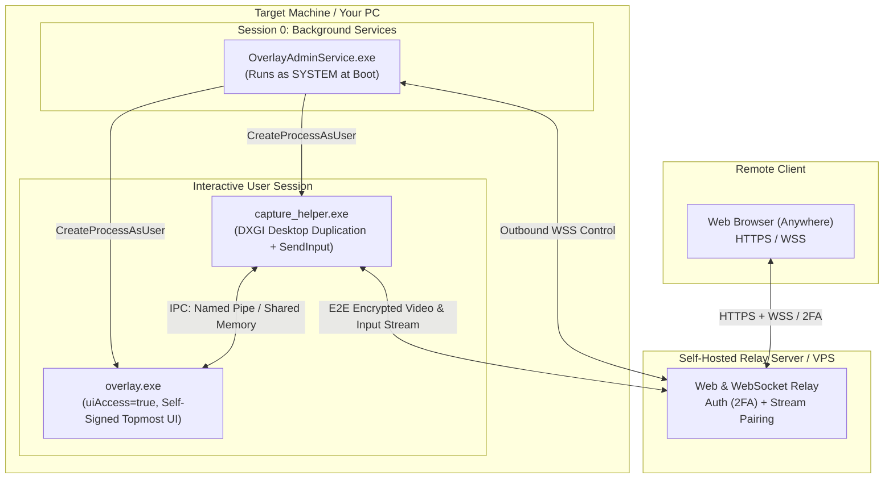

# Personal Remote KVM & Overlay System

A completely self-hosted, private remote desktop and status overlay engine designed to access and control your personal PC remotely through any browser without exposing your home network or relying on proprietary third-party platforms.

The system is split into three main layers:
1. **Cloud / VPS Relay Server**: Facilitates secure pairing, user authentication, and data transfer via outbound WebSockets (no port-forwarding required).
2. **SYSTEM Background Service**: Auto-starts at boot to handle session lifecycle management, survivability across user logoffs, and privileged orchestration.
3. **User-Session Helpers**: The actual and screen-capture/input engine running inside the interactive desktop session.

---

## Architecture Overview



---

## Components

| Component | Privilege / Level | Session | Responsibility |
|---|---|---|---|
| **Relay Server** | User / Container | Cloud / VPS | Hosts the web client, and bridges outbound WebSockets between browser and host. |
| **`hawk-service.exe`** | `NT AUTHORITY\SYSTEM` | Session 0 | Boots before user login, maintains outbound relay heartbeat, monitors logon events, and spawns session helpers. |
| **`hawk-capture.exe`** | Interactive User | Active Desktop | Low-overhead screen capture via DXGI Desktop Duplication API and input simulation via `SendInput`. |

---

## Windows Security Subsystems & Design Choices

### 1. Session 0 Isolation
Introduced in Windows Vista, background services run in an isolated session (`Session 0`) without access to any display hardware or interactive input devices. A service cannot capture the screen or display windows directly. 
* **Implementation:** The service queries active session IDs via `WTSEnumerateSessions` / `WTSQueryUserToken` and spawns interactive components into the user's session using `CreateProcessAsUser`.

### 2. UIPI & `uiAccess`
* **Implementation:** `hawk-capture.exe` embeds an application manifest setting `uiAccess="true"`. This allows it to overlay windows to maintain topmost Z-order even over elevated windows. As well as capturing UAC prompt.
* **Requirements:** The executable must be signed with a certificate that chains to a locally trusted root (via `CertMgr`) and must reside in a protected directory (e.g., `%ProgramFiles%`).

### 3. Outbound-Only Networking
Instead of opening firewall ports or port-forwarding a home router, both the browser and the target PC initiate outbound WebSocket connections to the self-hosted relay server. The relay handles session handshakes and pairs the two connections.

---

## Security Mitigations
* **Relay Authentication:** The cloud relay acts as the primary gatekeeper. Access requires strong authentication to prevent unauthorized remote sessions.
* **End-to-End Encryption (E2EE):** Video frames and input events are encrypted end-to-end between the interactive capture helper and your browser using a pre-shared or session-derived key. The relay server only routes opaque ciphertext payloads.
* **Granular IPC & Shared Memory Hardening:**
  * **Strict DACLs (No Broad `AU` Grants):** Cross-session shared memory objects (`Global\`) and synchronization events (`CreateEvent`) created by the SYSTEM service must not grant blanket `Authenticated Users` (`AU`) access. Instead, construct explicit SDDL strings or programmatic DACLs granting permissions strictly to `NT AUTHORITY\SYSTEM` and the specific logged-on user's SID retrieved via `WTSQueryUserToken`.
  * **Double-Buffering & State Validation:** Use double-buffered (ping-pong) shared memory paired with named Win32 events (`SetEvent` / `WaitForSingleObject`) with reasonable timeouts (e.g., 50–100ms) to prevent deadlock or race conditions if one process crashes or hangs mid-write.
* **Channel Separation (Control vs. Data):**
  * **Shared Memory (`CreateFileMapping` + `MapViewOfFile`):** Exclusively utilized for zero-copy transmission of bulk frame buffers.
  * **Named Pipes (`CreateNamedPipe`):** Retained for low-frequency control signaling, heartbeats, and input ingestion, isolated using strict pipe security descriptors and `PIPE_REJECT_REMOTE_CLIENTS`.
* **Self-Signed Scope & Isolation:** The custom root certificate generated for `uiAccess` signing is restricted strictly to the local machine's `Root` and `TrustedPublisher` stores and must never be distributed or imported onto foreign devices.
* **TLS Public Key Pinning (Anti-MITM):** The background service and capture helper do not rely solely on the Windows root trust store. They implement **SPKI (Subject Public Key Info) SHA-256 pinning** on outbound TLS/WSS connections to the relay server. Any connection where the server's public key hash does not match the embedded pin is immediately dropped, thwarting DNS hijacking, malicious proxies, and compromised root Certificate Authorities.
* **Hardware-Bound Identity via TPM 2.0:** The SYSTEM service leverages the **Microsoft Platform Crypto Provider** (ncrypt) to generate an asymmetric device identity key directly inside the motherboard's physical TPM. The private key is non-exportable and never enters system RAM or disk storage. During relay connection handshakes, the service signs authentication challenges entirely within the secure cryptoprocessor, preventing device spoofing even in the event of local disk imaging or storage theft.


---

## Compilation & Toolchain

TODO

---

## Implementation Roadmap

- [x] Background SYSTEM service architecture & session monitoring
- [x] MinGW-w64 cross-compilation pipeline and CMake setup
- [ ] `uiAccess` manifest
- [ ] self-signed certificate automation
- [ ] DXGI Desktop Duplication screen capture loop
- [ ] Keyboard/mouse input ingestion via `SendInput`
- [ ] Self-hosted web relay server
- [ ] Web browser client (Canvas/WebGL stream player + input listener)
```
